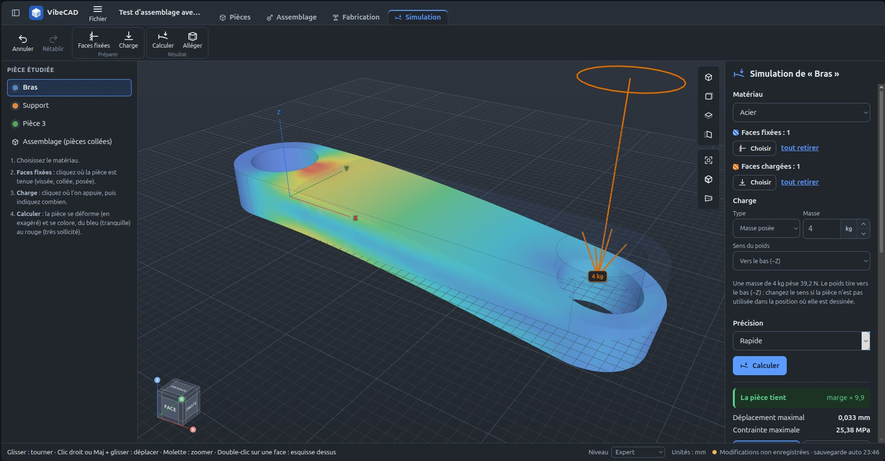

<!-- Page générée par scripts/sync-site-docs.mjs depuis VibeCAD/docs/simulation.md : modifier la source, pas cette page. -->


Onglet « Simulation » (niveau Intermédiaire) : montrer comment une pièce se déforme et où elle
risque de casser, sous une charge simple. Le résultat est **indicatif** et pédagogique : une pièce
imprimée dépend aussi du remplissage et du sens des couches.

## Utilisation

1. Choisir la **pièce étudiée** (panneau de gauche) et son **matériau** (panneau de droite ; par
   défaut, la matière de la pièce choisie dans ses Propriétés).
2. **Faces fixées** : cliquer les faces où la pièce est tenue (vissée, collée, posée). Un second
   clic retire une face ; Échap termine.
3. **Charge** : cliquer les faces où l'on appuie, puis indiquer une **masse posée** (kg) ou une
   **force** (N) et son sens : « appuie sur la face » (vers l'intérieur de la pièce), « tire sur la
   face », un axe du repère, ou une **direction au choix** (trois composantes X, Y, Z, par exemple
   0 ; 1 ; −1 pour 45° vers +Y et vers le bas). Le poids d'une masse tire vers le bas (−Z) par
   défaut ; son sens se change aussi, pour une pièce qui ne sera pas utilisée dans la position où
   elle est dessinée. La flèche de la vue montre le sens choisi. Une face est fixée ou chargée, pas
   les deux.
4. **Calculer** : la pièce apparaît déformée (exagérée, pour que la déformation se voie) et colorée
   du bleu (peu sollicitée) au rouge (très sollicitée), en contrainte ou en déplacement. Le
   **verdict** compare la contrainte maximale à la résistance du matériau :
   « La pièce tient » (marge ≥ 2), « C'est juste » (1 à 2), « Risque de casser » (< 1).
   **Animer** fait aller et venir la pièce entre sa forme de départ et la déformée (aller-retour
   de 1,6 s), pour voir dans quel sens elle plie ; l'animation est coupée si le système demande
   moins d'animations (réglage d'accessibilité).

Quand le plus grand déplacement dépasse 5 % de la taille de la pièce, un avertissement rappelle
que le calcul suppose de petites déformations : la forme réelle sera différente (c'est le cas
courant d'une pièce souple en TPU, qui plie beaucoup sans casser).

**Assemblage collé** (niveau Expert) : dans la liste des pièces, « Assemblage (pièces collées) »
étudie toutes les pièces insérées, à leur place et dans le même matériau. Les faces fixées et
chargées se cliquent sur n'importe quelle pièce (elles sont repérées par pièce insérée). Chaque
pièce est découpée en cubes sur une même grille : deux pièces qui se touchent partagent des nœuds,
elles sont donc collées (ni jeu, ni glissement, pas de contact). La matière qui ne touche aucune
face fixée, même par l'intermédiaire d'une autre pièce, flotterait : elle est laissée de côté
avec un avertissement, et si la charge appuie dessus le calcul est refusé avec une explication.

La précision (Rapide, Normale, Fine) règle le nombre de cubes : environ 3 000, 8 000 ou 20 000.
Les réglages sont enregistrés dans le projet (champ `simulation` du format natif, annulables) ;
le résultat ne l'est pas : il se recalcule. Si les réglages ou la pièce changent, le résultat est
signalé comme périmé.

| Matériau | E (MPa) | ν | Résistance retenue (MPa) |
| --- | --- | --- | --- |
| PLA imprimé | 3 000 | 0,36 | 30 |
| PETG imprimé | 2 000 | 0,38 | 30 |
| ABS imprimé | 1 900 | 0,35 | 25 |
| TPU imprimé (souple) | 30 | 0,45 | 20 |
| Contreplaqué | 6 000 | 0,3 | 25 |
| Acrylique (PMMA) | 3 000 | 0,37 | 35 |
| Aluminium | 69 000 | 0,33 | 150 |
| Acier | 200 000 | 0,3 | 250 |

Les résistances des plastiques imprimés sont prudentes (couches, remplissage). L'acrylique est
cassant (il casse sans plier) et les bords découpés au laser ont des micro-fissures : sa
résistance retenue est bien inférieure aux 60 à 70 MPa des fiches techniques.

## Méthode

- **Cubes (voxels)** : la pièce est découpée en cubes réguliers d'arête `h` ;
  un cube est plein si son centre est dans la pièce (rayons parallèles à x et parité des
  traversées du maillage fermé). Robuste sur toute forme, y compris un STL importé. La taille `h`
  vise le nombre de cubes de la précision choisie, et la plus petite dimension de la pièce (souvent
  son épaisseur) compte un nombre entier de cubes : sinon la grille l'épaissirait d'un demi-cube et
  la pièce paraîtrait trop raide.
- **Éléments finis** : élasticité linéaire, petits déplacements ; chaque cube
  est un hexaèdre à 8 nœuds avec **modes incompatibles** (Wilson-Taylor) condensés, sans lesquels
  ces cubes seraient environ 30 % trop raides en flexion. Tous les cubes étant identiques, la
  raideur élémentaire (24 × 24) est calculée une fois.
- **Résolution** sans matrice globale ; contraintes de von Mises au centre de chaque cube.
  Au-delà de 1 000 cubes, le gradient conjugué est préconditionné par **multigrille** :
  grilles 2h, 4h… (un cube grossier regroupe 2 × 2 × 2 cubes, raideur
  proportionnelle à sa part de matière), interpolation trilinéaire, lissage de Jacobi amorti
  (4 / 3λmax, λmax estimée par la méthode de la puissance), grille la plus grossière (~400 cubes)
  résolue directement (Cholesky), cycle en V dans un gradient conjugué flexible. Le résultat est
  identique (test : écart < 10⁻⁶ de la flèche) ; seul le nombre d'itérations baisse. Essai écarté :
  ne pas grossir l'épaisseur d'une plaque (pavés 2h × 2h × h) rend le lissage inefficace (six fois
  plus d'itérations).
- **Conditions aux limites** : nœuds de surface (touchant un cube vide) à moins de 0,75 `h` d'une
  face cliquée : bloqués (encastrement) ou chargés (force totale répartie également).
- **Affichage** : le maillage de la pièce est subdivisé (arêtes ≤ 1,5 `h`, découpe conforme, sans
  fente) ; chaque sommet reçoit le déplacement interpolé dans le cube plein le plus proche et la
  contrainte moyenne des cubes voisins. L'exagération porte le plus grand déplacement à environ
  8 % de la taille de la pièce.
- Le calcul tourne dans un **worker dédié** : l'interface et le
  worker géométrique restent disponibles ; « Annuler » arrête le worker.

## Alléger la pièce (optimisation topologique)

Section « Alléger la pièce » du panneau de droite (pièce seule, pas l'assemblage) : avec les mêmes
faces fixées, la même charge et la même précision, le calcul cherche **où la matière travaille
vraiment** et ne garde que la part choisie (10 à 90 %, 40 % par défaut) : la pièce la plus raide
possible avec moins de matière.

1. Préparer l'étude comme pour « Calculer » (faces fixées, charge, précision). Facultatif :
   **Faces à garder** (en vert) : le bord d'un perçage, une face d'appui… restent pleins. Elles
   sont enregistrées dans le projet avec l'étude, sans périmer le calcul de déformation.
2. Choisir la **matière gardée** et, si besoin, une **forme symétrique** (gauche-droite,
   avant-arrière ou haut-bas : la forme se reflète par le plan médian de la pièce, même si la
   charge n'est pas symétrique), puis **Alléger la pièce** : une barre montre l'avancement
   (« Annuler » l'arrête). Environ 10 s en précision Rapide, 20 s en Normale, une minute en Fine.
3. La forme obtenue s'affiche en **orange** devant la pièce d'origine (transparente). Le panneau
   indique la matière gardée et la **raideur gardée** (souplesse de la pièce pleine / souplesse de
   la forme : 37 % de la raideur avec 40 % de la matière pour une console, par exemple).
4. **Seuil** : la forme garde les cubes « remplis » à au moins ce seuil (50 % par défaut) ; plus
   haut, seule la matière la plus utile reste. La forme se recalcule aussitôt.
5. **Exporter en STL** (pour imprimer la forme telle quelle) ou **Nouvelle pièce** : pour une
   pièce plate, une esquisse (le contour de la forme, en segments) extrudée de l'épaisseur de la
   plaque, à la place de la pièce d'origine : une vraie pièce, modifiable (congés, perçages…) et
   découpable au laser ; sinon la forme rejoint le projet par la fenêtre d'import STL, comme pièce
   figée. « Revenir à la pièce » referme la forme.

La forme est indicative : en petits cubes lissés, elle sert surtout à **comprendre** où passer la
matière (nervures, trous, bras en diagonale) avant de redessiner une pièce propre. La forme et
la part gardée ne sont pas enregistrées dans le projet (seules les faces à garder le sont) :
comme le résultat de la simulation, la forme se recalcule. Si les réglages ou la pièce changent,
elle est signalée comme périmée.

**Pièce plate** (épaisseur au plus 35 % de sa dimension moyenne) : la forme est la même dans toute
l'épaisseur et les trous la traversent, comme pour une découpe laser. Sans cela, le calcul
amincirait la plaque par l'intérieur, ce qui ne se fabrique pas.

### Méthode

Le calcul tourne dans le worker de simulation :

- **SIMP** (Bendsøe et Sigmund) sur la grille de cubes de l'étude : chaque cube de la pièce reçoit
  une densité ρ ∈ [0, 1] et la raideur E · (Emin + (1 − Emin) ρ³), Emin = 10⁻³. La pénalisation
  (exposant 3) rend les densités moyennes peu rentables : le résultat tend vers du plein ou du vide.
- On minimise la **souplesse** (travail de la charge) à volume donné. À chaque itération : calcul
  de la déformation (solveur multigrille du calcul de déformation, raideur par cube, en repartant
  de la solution précédente, précision 3 · 10⁻³ : même résultat qu'à 10⁻⁴, 30 % plus vite),
  sensibilité = énergie de chaque cube, **filtre de
  densité** (rayon 1,5 cube : ni damier ni détails plus fins que la grille), mise à jour par
  **critère d'optimalité** (pas limité à 0,2, multiplicateur du volume par dichotomie). Arrêt
  quand aucune densité ne bouge de plus de 1 %, ou que la souplesse gagne moins de 0,2 % en
  5 itérations (60 au plus).
- Les cubes qui touchent une face fixée, chargée ou à garder restent pleins : la pièce garde ses
  appuis, l'endroit où l'on appuie et ce que l'élève a choisi. S'ils font déjà la part demandée
  (une grande face d'une plaque, par exemple), un avertissement le dit. Sur une pièce en 3D, une
  grande face fixée ou chargée reste comme un mur qui cache l'intérieur : le panneau conseille de
  choisir de petites faces (bord d'un trou, plot).
- Pièce plate : une variable par colonne de cubes dans l'épaisseur (sensibilités et volume
  additionnés sur la colonne, filtre dans le plan). Symétrie : un cube et son reflet partagent
  leur variable (le filtre voit les voisins de l'autre côté du plan comme des reflets).
- **Forme** (`topologySurface`) : cubes au-dessus du seuil ; les contacts par une arête ou un coin
  sont comblés par un cube voisin, seuls les morceaux reliés par des faces et tenus par une face
  fixée sont gardés ; surface des cubes (chaque arête partagée par deux triangles exactement)
  lissée par la méthode de Taubin (lissage sans rétrécissement).
- **Contour d'une pièce plate** : courbes de niveau
  (« marching squares ») des densités par colonne, au seuil, en respectant les cubes gardés et
  écartés de la forme 3D (le contour suit les densités : biais lisses plutôt que marches) ;
  simplification de Douglas-Peucker (0,2 cube) ; trous et îlots de moins de 1,5 cube² ignorés.

## Suite possible

- Optimisation topologique : zones à laisser vides choisies par l'élève, contrainte de fabrication (impression sans support) ; forme lissée
  par « marching cubes » plutôt que par cubes lissés.
- mesurer sur un ordinateur d'école ; si besoin, réduire encore le coût d'une itération (produit
  matrice-vecteur par nœud plutôt que par cube).

